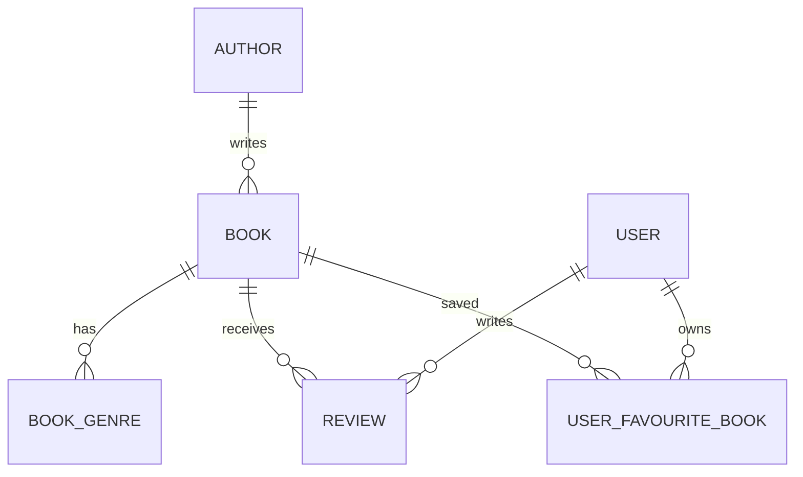

# BookHaven Implementation

- **Last updated:** 2026-11-20
- **Current phase:** Authenticated catalogue foundation

## Completed

- [x] Book domain includes title, short/long description, author, picture URL,
  multiple genres, pages, publish year, average stars, vote count, and reviews.
- [x] Author includes name and description.
- [x] Review includes user, book, text, stars, and creation time.
- [x] User includes email/password hash and favourite books; username removed.
- [x] Added `BookGenre` and `UserFavouriteBook` navigation entities.
- [x] Added one EF configuration file per entity.
- [x] Removed book create/update/delete repository and API operations.
- [x] Added authenticated `GetAllBooks`, `GetBook`, favourite, and review routes.
- [x] Split `BooksController`, `UsersController`, and `BaseController`.
- [x] Added minimal Program extensions for services, configuration, and pipeline.
- [x] Split every backend DTO and enum into its own file.
- [x] Guarded the whole frontend application behind login/register.
- [x] Removed header/footer from public auth routes.
- [x] Added top-right profile avatar with email and Logout dropdown.
- [x] Replaced local My Library persistence with authenticated favourites query.
- [x] Added automatic sign-out on API `401`.
- [x] Added eight application-service unit tests.
- [x] Added a VS Code full-stack task for the frontend and backend.
- [x] Configured API HTTP `5000`, HTTPS `7000`, and IIS Express SSL `44300`.
- [x] Added Swagger UI and automatic local opening at startup.
- [x] Added twelve deterministic catalogue books with Open Library covers.
- [x] Implemented catalogue search, genre filtering, sorting, pagination, and
  a responsive card grid with URL-backed filter state.
- [x] Implemented responsive book details with metadata, ratings, genres, and
  full descriptions.
- [x] Implemented favourite add/remove and server-backed My Library management.
- [x] Implemented review add/edit/delete with ownership enforcement.
- [x] Added password confirmation validation to frontend registration and API.
- [x] Simplified all card borders to standard solid borders.
- [x] Renamed the application service and interface to `BookService` and
  `IBookService`.
- [x] Replaced cool-blue and gradient backgrounds with a brighter solid
  pale-orange page background and white surfaces.
- [x] Added pointer feedback to interactive controls and underline-only header
  navigation states.
- [x] Reworked the profile avatar and dropdown with a neutral person icon.
- [x] Centered desktop navigation independently inside the full-width header.
- [x] Removed the catalogue list-view mode and redundant section kickers.
- [x] Aligned catalogue filters in a white panel beside the complete card grid.
- [x] Reworked book reviews into a server-backed summary, rating breakdown,
  review list, and centered rating/text modal without a display-name field.

## Current schema

## Endpoints

| Method | Route | Auth |
| --- | --- | --- |
| `GET` | `/api/books` | Required |
| `GET` | `/api/books/{id}` | Required |
| `POST` | `/api/books/{id}/favourites` | Required |
| `DELETE` | `/api/books/{id}/favourites` | Required/owner |
| `POST` | `/api/books/{id}/reviews` | Required |
| `PUT` | `/api/books/reviews/{reviewId}` | Required/owner |
| `DELETE` | `/api/books/reviews/{reviewId}` | Required/owner |
| `POST` | `/api/users/register` | Public |
| `POST` | `/api/users/login` | Public |

## Verification

- [x] Backend build: 0 warnings, 0 errors.
- [x] Backend tests: 8 passed, 0 failed.
- [x] Frontend ESLint passed.
- [x] Frontend production build passed.

## Next work

- [ ] Replace deterministic seed data with an import only if the coursework
  requires a larger live catalogue.
- [ ] Add focused frontend component tests at the end of the project.
- [ ] Replace development JWT key for deployment.
- [ ] Introduce migrations when schema history is required.
