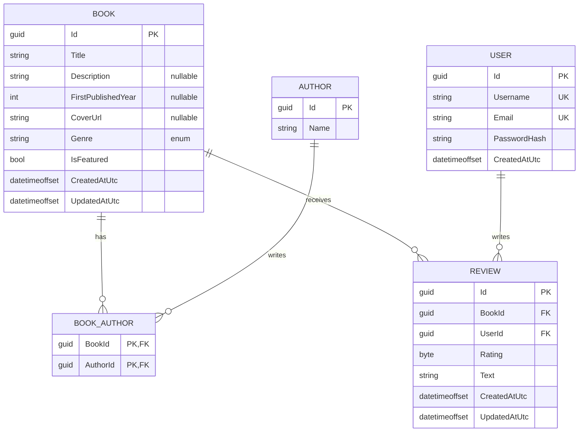

# BookHaven Implementation

Living implementation status for the simplified React + .NET application.

- **Last updated:** 2026-11-19
- **Current phase:** Book API, repository, and simple authentication foundation
- **Tests:** Add small unit tests after the remaining pages/use cases stabilize

## Completed

### Frontend foundation

- [x] React, Vite, TypeScript, React Router, React Query, Axios, MUI, Tailwind.
- [x] Home page, full-width header, simple footer, My Library prototype, and 404.
- [x] Removed separate Favorites and Home genre section.
- [x] Added `/login` and `/register` pages.
- [x] Added `AuthProvider`, JWT LocalStorage persistence, and sign-out.
- [x] Added Axios bearer-token interceptor.
- [x] Changed featured books from Open Library to the BookHaven API.

### Backend structure

- [x] Removed `BookHaven.Infrastructure` from disk, references, and solution.
- [x] Kept Api, Application, Domain, Persistence, and Tests projects.
- [x] Added EF Core SQLite and JWT bearer packages through central package
  management.
- [x] Added one `BookHavenService` and one `BookHavenController`.
- [x] Added repository interfaces under `Application/Interfaces`.
- [x] Added `BookRepository` and minimal `UserRepository` implementations.
- [x] Added separate ApiDto, Application DTO, and Repository DTO models.
- [x] Added handwritten mapping in every layer.

### Domain and persistence

- [x] Converted genres to the `Genre` enum.
- [x] Added navigation properties for Book, Author, BookAuthor, Review, and User.
- [x] Removed Genre and BookGenre entities/tables.
- [x] Added `BookHavenDbContext`.
- [x] Added one EF configuration file per entity.
- [x] Added SQLite startup creation with `EnsureCreated`.
- [x] Enforced one review per `(BookId, UserId)`.

### Authentication

- [x] Register with username, email, and password.
- [x] PBKDF2 password hashing with random salt.
- [x] Login with email and password.
- [x] Two-hour JWT creation and validation.
- [x] Protected book and review write endpoints.
- [x] Review updates/deletes are limited to the token user.

## Current schema



Genres:

```text
Fiction
ScienceFiction
Fantasy
Mystery
NonFiction
History
Biography
Romance
```

## Endpoint status

| Method | Route | Status |
| --- | --- | --- |
| `GET` | `/api/books` | Implemented |
| `GET` | `/api/books/{id}` | Implemented |
| `POST` | `/api/books` | Implemented, JWT |
| `PUT` | `/api/books/{id}` | Implemented, JWT |
| `DELETE` | `/api/books/{id}` | Implemented, JWT |
| `POST` | `/api/books/{bookId}/reviews` | Implemented, JWT |
| `PUT` | `/api/reviews/{reviewId}` | Implemented, JWT owner |
| `DELETE` | `/api/reviews/{reviewId}` | Implemented, JWT owner |
| `POST` | `/api/auth/register` | Implemented |
| `POST` | `/api/auth/login` | Implemented |

Catalog query supports search, genre, sort, featured-only, page, and page size.

## Verification completed

- [x] Backend restore.
- [x] Backend build: zero warnings and zero errors.
- [x] Frontend production build.
- [x] Live register request returned user and JWT.
- [x] Authorized book creation succeeded.
- [x] Authorized review creation succeeded.
- [x] Featured catalog returned the created book.
- [x] Smoke-test database removed after verification.

## Next work

- [ ] Finish catalog UI against `GET /api/books`.
- [ ] Finish book details UI against `GET /api/books/{id}`.
- [ ] Add authenticated create/edit book forms if exposed in the UI.
- [ ] Add authenticated review form to details.
- [ ] Decide whether My Library stays local or becomes a user-book relation.
- [ ] Add a global frontend response handler for expired/invalid JWTs.
- [ ] Move the development JWT key to user secrets/environment before deployment.
- [ ] Add migrations if schema evolution is required.

## Later simple tests

Backend:

- password hash round-trip and invalid password;
- registration duplicate conflict;
- book validation and query normalization;
- review rating/text validation;
- mapping between Repository DTO and Application DTO.

Frontend:

- auth storage and sign-out;
- Axios bearer header attachment;
- login/register success and API error messages;
- featured-book API mapping.
