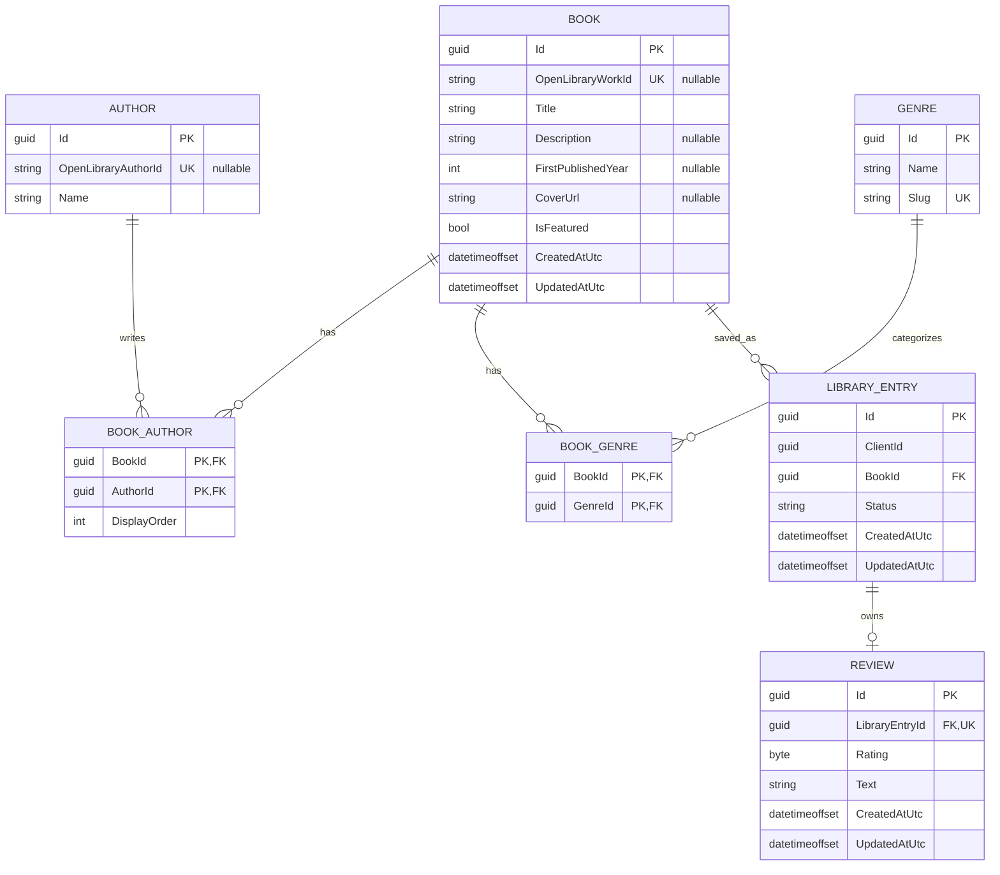

# BookHaven Implementation Plan

This is the living delivery plan for BookHaven. It tracks current scope,
proposed schema, API contracts, implementation state, and verification. Reusable
rules live in the frontend and backend convention files; the accepted cross-stack
architecture lives in the single ADR.

## Status

- **Project phase:** Full-stack foundation and schema definition
- **Last updated:** 2026-11-18
- **Current branch:** `feature/book-pages`
- **Current focus:** Define the backend model and contracts before persistence
  and endpoint implementation
- **Frontend:** Home page, shared shell, My Library prototype, and 404 exist
- **Backend:** .NET 10 layered solution exists; domain objects and contracts are
  defined; persistence and controllers are not implemented
- **Tests:** Intentionally deferred until validation and use cases exist

### Status legend

- `[ ]` planned
- `[~]` in progress
- `[x]` complete and verified
- `[!]` blocked with the reason documented beside the item

Only mark work complete after its stated verification passes.

## 1. Accepted product scope

BookHaven will provide:

1. Home page with a library introduction and featured books.
2. Catalog with title/author search, genre filtering, sorting, and pagination.
3. Dynamic book details at `/books/:id`.
4. My Library as the only saved-book collection.
5. `WantToRead`, `Reading`, and `Completed` reading statuses.
6. One personal review per saved book, with add, edit, and delete actions.
7. Add/edit book forms to demonstrate `POST` and `PUT` API operations.
8. About content and a branded 404 page.

There is no separate Favorites feature. Adding a book to My Library is the
saved-book action. Authentication, borrowing, payments, social reviews, and
microservices are out of scope.

## 2. Architecture snapshot

The accepted structure is documented in
[`docs/adr/0000-project-structure.md`](docs/adr/0000-project-structure.md).

```text
React component
  -> custom React Query hook
  -> feature API module
  -> configured Axios client
  -> ASP.NET Core controller
  -> Application use case/port
  -> Domain model
  -> Persistence or Infrastructure implementation
```

Backend dependency direction:

```text
Api -> Application -> Domain
Api -> Persistence -> Application
Api -> Infrastructure -> Application
Tests -> Application + Domain
```

The current direct frontend request to Open Library is transitional. The final
frontend calls only BookHaven's API; the backend owns any Open Library
integration and maps upstream data into the internal model.

## 3. Page and route matrix

| Frontend route | API data | Required states | Main actions |
| --- | --- | --- | --- |
| `/` | Featured books | Loading, error, empty, populated | Browse catalog, open details |
| `/books` | Paged books | Loading, fetching, error, empty, populated | Search, filter, sort, page |
| `/books/new` | None/lookups | Form, validation, submitting, error | Create book (`POST`) |
| `/books/:id` | Book details | Loading, error, not found, populated | Add/remove My Library |
| `/books/:id/edit` | Book details | Loading, form, validation, submitting | Edit book (`PUT`) |
| `/my-library` | Anonymous client's entries | Loading, error, empty, populated | Status and review CRUD |
| `/about` | Static | Populated | Explain coursework/project |
| `*` | None | Static | Return home/catalog |

## 4. Proposed relational schema

This schema is intentionally small, normalized enough for the required filters,
and provider-neutral until the EF Core provider is selected.



### Entity definitions

| Entity | Purpose | Important rules |
| --- | --- | --- |
| `Book` | Catalog and details data | Title required; optional Open Library ID, description, year, and cover; `IsFeatured` drives Home |
| `Author` | Search/sort author data | Name required; optional external author ID |
| `Genre` | Stable catalog classification | Name and URL-safe slug required; slug unique |
| `BookAuthor` | Book-author many-to-many join | Composite key; `DisplayOrder` preserves author order |
| `BookGenre` | Book-genre many-to-many join | Composite key prevents duplicates |
| `LibraryEntry` | One anonymous client's saved book | Unique `(ClientId, BookId)`; status required |
| `Review` | Personal review for a saved book | Unique `LibraryEntryId`; rating 1-5; trimmed non-empty text |

### Length and range rules

| Field | Rule |
| --- | --- |
| Book title | Required, maximum 300 characters |
| Book description | Maximum 5,000 characters |
| Cover URL | Valid absolute HTTP(S) URL, maximum 2,048 characters |
| External IDs | Maximum 50 characters |
| Author name | Required, maximum 200 characters |
| Genre name/slug | Required, maximum 100 characters |
| First published year | Sensible positive year, not beyond the current year unless explicitly allowed |
| Review rating | Integer from 1 through 5 |
| Review text | Required after trimming, maximum 2,000 characters |

### Keys, indexes, and delete behavior

Planned unique indexes:

- `Book.OpenLibraryWorkId` when not null;
- `Author.OpenLibraryAuthorId` when not null;
- `Genre.Slug`;
- `(BookAuthor.BookId, BookAuthor.AuthorId)`;
- `(BookGenre.BookId, BookGenre.GenreId)`;
- `(LibraryEntry.ClientId, LibraryEntry.BookId)`;
- `Review.LibraryEntryId`.

Planned delete behavior:

- deleting a book cascades its author/genre join rows;
- deleting a library entry cascades its review;
- deleting an author or genre referenced by a book is restricted;
- deleting a book referenced by any library entry is restricted and returns a
  conflict until those entries are removed.

### Anonymous client ownership

The frontend generates one GUID and stores it as:

```text
bookhaven.client-id.v1
```

Library and review requests send:

```http
X-BookHaven-Client-Id: <guid>
```

This scopes data for coursework without implementing login. It is not secure
identity: clearing LocalStorage creates a new library scope.

### Initial code locations

```text
BookHaven.Domain/
  Books/
    Book.cs
    Author.cs
    Genre.cs
    BookAuthor.cs
    BookGenre.cs
    BookRules.cs
  Library/
    LibraryEntry.cs
    ReadingStatus.cs
    Review.cs
    ReviewRules.cs

BookHaven.Application/
  Common/Models/PagedResult.cs
  Books/Contracts/
  Library/Contracts/
```

These objects are dependency-free definitions. EF Core configurations,
validation, service interfaces, and mapping are the next backend steps.

## 5. Proposed API contract

### Books

| Method | Route | Input | Output/result |
| --- | --- | --- | --- |
| `GET` | `/api/books` | `search`, `author`, `genre`, `sort`, `isFeatured`, `page`, `pageSize` | `PagedResult<BookSummaryResponse>` |
| `GET` | `/api/books/{id}` | Book GUID | `BookDetailsResponse` or 404 |
| `POST` | `/api/books` | `CreateBookRequest` | 201 + created details/location |
| `PUT` | `/api/books/{id}` | `UpdateBookRequest` | Updated details or 404 |
| `DELETE` | `/api/books/{id}` | Book GUID | 204, 404, or 409 when referenced |

Supported sorts:

```text
titleAscending
titleDescending
authorAscending
newest
oldest
```

Book create/update payloads contain title, description, author names, genre
names, first-published year, cover URL, optional Open Library work ID, and
featured flag. Application logic will trim, normalize, validate, and map these
values to relational records.

### My Library and reviews

Every route below requires `X-BookHaven-Client-Id`.

| Method | Route | Input | Output/result |
| --- | --- | --- | --- |
| `GET` | `/api/library` | Optional status filter | Client's library entries |
| `POST` | `/api/library` | Book ID + initial status | 201 or 409 duplicate |
| `PUT` | `/api/library/{bookId}` | New status | Updated entry or 404 |
| `DELETE` | `/api/library/{bookId}` | None | 204 or 404 |
| `POST` | `/api/library/{bookId}/review` | Rating + text | 201 or 409 duplicate |
| `PUT` | `/api/library/{bookId}/review` | Rating + text | Updated review or 404 |
| `DELETE` | `/api/library/{bookId}/review` | None | 204 or 404 |

The API serializes reading statuses as camelCase strings:

```text
wantToRead
reading
completed
```

### Error shape

Use ASP.NET Core Problem Details for errors. Validation failures include a
field-to-messages map. The frontend maps status codes and safe messages to its
shared error state and never displays stack traces or raw database/upstream
errors.

## 6. Frontend integration target

- Configure Axios for the BookHaven API base URL.
- Attach `X-BookHaven-Client-Id` centrally for library/review requests.
- Keep every HTTP call behind a feature API function and custom React Query
  query/mutation hook.
- Store catalog query, filters, sort, and page in URL search parameters.
- Use backend GUIDs in `/books/:id`.
- Invalidate only affected React Query keys after mutations.
- Remove the direct Open Library query after the BookHaven catalog endpoint is
  available.
- Do not store library or review response objects in LocalStorage.

## 7. Delivery phases

### Phase 0 - Documentation and baseline

- [x] Create root README with Microsoft-inspired layered structure.
- [x] Maintain separate frontend and backend convention documents.
- [x] Record frontend and backend decisions in one ADR.
- [x] Replace frontend-only assumptions with the accepted full-stack boundary.
- [x] Define the proposed relational schema and API routes.

Verification: README, conventions, ADR, and this plan agree on data ownership,
route IDs, My Library, and LocalStorage use.

### Phase 1 - Existing frontend foundation

- [x] Scaffold React + Vite + TypeScript.
- [x] Install React Router, React Query, Axios, MUI, and Tailwind.
- [x] Create feature-first folders, providers, router, and shared shell.
- [x] Build the Home hero and featured shelf prototype.
- [x] Build the branded 404 and simplified full-width header/footer.
- [x] Remove the separate Favorites feature and genre section from Home.
- [~] Keep direct Open Library featured data only until backend replacement.

Verification completed previously: lint and production build passed for the
frontend foundation. Re-run after API migration.

### Phase 2 - Backend solution foundation

- [x] Create .NET 10 solution and Api/Application/Domain/Persistence/
  Infrastructure/Tests projects.
- [x] Add central package management, shared build props, NuGet config, and
  backend editor config as solution items.
- [x] Use `BookHaven.Api` casing consistently.
- [x] Define Book, Author, Genre, join, LibraryEntry, Review, status, and rule
  objects.
- [x] Define book/library request and response records and `PagedResult<T>`.
- [ ] Add service/use-case interfaces and implementations.
- [ ] Add validation and explicit application outcomes.

Verification: solution builds with warnings as errors; Domain has no external
package dependencies.

### Phase 3 - Persistence

- [ ] Select and document the EF Core provider.
- [ ] Add provider and design packages through central package management.
- [ ] Implement `BookHavenDbContext` and entity configurations.
- [ ] Configure all keys, indexes, lengths, enum conversion, and delete behavior.
- [ ] Implement catalog and library data-access ports.
- [ ] Add the initial migration and development database configuration.
- [ ] Add a small deterministic seed set with featured books and genres.

Verification: migration creates the documented schema; duplicate library/review
constraints fail predictably; no connection secrets are committed.

### Phase 4 - Application and API

- [ ] Implement catalog query/filter/sort/page behavior.
- [ ] Implement book details/create/update/delete behavior.
- [ ] Implement My Library add/list/status/remove behavior.
- [ ] Implement review create/update/delete behavior.
- [ ] Add anonymous client ID parsing/validation.
- [ ] Add controllers, Problem Details, enum serialization, and OpenAPI.
- [ ] Configure CORS or Vite proxy for local development.
- [ ] Add Open Library import/client only if the coursework flow needs it.

Verification: each documented endpoint returns the intended success and error
status; controllers contain no EF queries.

### Phase 5 - Catalog and details frontend

- [ ] Point Axios at BookHaven API and remove direct Open Library calls.
- [ ] Implement typed book query keys and hooks.
- [ ] Implement URL-driven search, filters, sort, and one-based pagination.
- [ ] Build catalog loading/error/empty/populated states.
- [ ] Build details with missing-data fallbacks and My Library action.
- [ ] Build add/edit book forms with API validation feedback.

Verification: reload/back/forward preserve catalog state; invalid IDs and 404s
are useful; create/edit flows call the intended HTTP methods.

### Phase 6 - My Library and reviews frontend

- [ ] Replace the LocalStorage library prototype with API queries/mutations.
- [ ] Add and validate the anonymous client ID helper.
- [ ] Add status filters/counts and status mutation.
- [ ] Add review create/edit form and delete confirmation.
- [ ] Handle duplicate/conflict and missing-entry responses.
- [ ] Confirm no Favorites route or parallel storage remains.

Verification: add/remove/status/review operations survive refresh through the
API and affect only the current anonymous client ID.

### Phase 7 - About, accessibility, and polish

- [ ] Add About content or route.
- [ ] Complete keyboard-only walkthrough.
- [ ] Check landmarks, headings, labels, alt text, focus, and live feedback.
- [ ] Verify 375, 768, 1024, and 1440 px layouts.
- [ ] Check slow network, empty catalog/library, API failure, and missing data.
- [ ] Confirm orange/gray/white tokens and restrained 5 px corners.
- [ ] Add final metadata, attribution, and branding assets.

### Phase 8 - Focused tests and handoff

- [ ] Add simple backend unit tests only after validators/use cases exist.
- [ ] Add frontend tests for query parameters, hooks, and key workflows.
- [ ] Add a small API/persistence integration suite after EF/controllers exist.
- [ ] Run frontend lint/build and backend restore/build/test.
- [ ] Prepare coursework demonstration paths and architecture explanation.

## 8. Planned simple unit tests

Do not add placeholder tests that only construct entities or assert constants.
The first useful backend tests will cover:

| Area | Example behavior |
| --- | --- |
| Book validation | Empty/overlong title is rejected; optional fields may be absent |
| Catalog query | Invalid page/page size normalizes or returns validation failure |
| Review validation | Rating outside 1-5 and blank/overlong text are rejected |
| Library behavior | Duplicate `(ClientId, BookId)` produces a conflict |
| Review behavior | A second review for one library entry produces a conflict |
| Mapping | Missing cover, year, description, authors, or genres maps safely |

The first useful frontend tests will cover:

- URL search-parameter parsing and reset-to-page-one behavior;
- anonymous client ID generation/reuse and Axios header attachment;
- query/mutation hooks with mocked API responses;
- loading, error, empty, and successful route states;
- My Library status and review actions.

Live Open Library calls and real production databases never run in automated
unit tests.

## 9. Risks and mitigations

| Risk | Impact | Mitigation |
| --- | --- | --- |
| Docs drift between old frontend-only and new API model | Conflicting implementation | README, conventions, ADR, and this plan now share one boundary |
| Anonymous ID mistaken for security | Incorrect privacy assumptions | Label it scope-only; no authentication claims |
| Open Library data is irregular | Missing/broken metadata | Backend normalization and nullable fields with designed UI fallbacks |
| EF provider selected too early | Provider-specific design churn | Keep schema/contracts provider-neutral until persistence phase |
| MUI/Tailwind overlap | Styling inconsistency | MUI for controls, Tailwind for layout, shared color tokens |
| Overengineering | Coursework hard to defend | No MediatR/generic repository/microservices without evidence |
| Direct frontend Open Library call remains | Split data boundary | Track as transitional and remove in Phase 5 |

## 10. Decision and progress log

| Date | Status | Entry |
| --- | --- | --- |
| 2026-11-17 | Completed | Created the React foundation, home experience, shared shell, and initial Open Library featured query. |
| 2026-11-18 | Decided | My Library is the only saved-book collection; Favorites remains removed. |
| 2026-11-18 | Completed | Added the .NET 10 layered backend solution and centralized build/package configuration. |
| 2026-11-18 | Decided | Adopted one full-stack ADR, Microsoft-inspired layered backend, feature-first frontend, and backend-owned data. |
| 2026-11-18 | Decided | Anonymous browser GUID scopes My Library without authentication. |
| 2026-11-18 | Completed | Defined the initial relational objects, request/response contracts, endpoint plan, and synchronized documentation. |

## 11. Next implementation slice

The next coherent slice is backend validation and persistence selection:

1. choose SQLite or SQL Server for coursework deployment;
2. add EF Core packages centrally;
3. implement entity configurations exactly from this schema;
4. implement book query/create/update use cases;
5. add the first controller only after those use cases can be tested directly.

Do not begin broad unit-test generation before steps 3-4 create behavior worth
testing.
