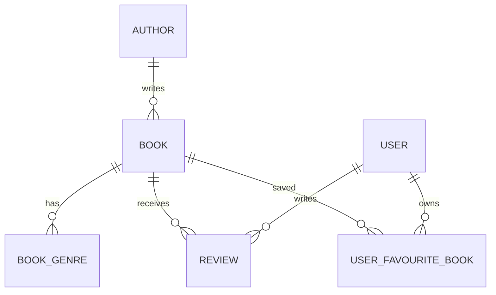

# BookHaven Implementation

- **Last updated:** 2026-11-19
- **Current phase:** Authenticated catalogue foundation

## Completed

- [x] Book domain includes title, short/long description, author, picture URL,
  multiple genres, pages, publish year, average stars, vote count, and reviews.
- [x] Author includes name and description.
- [x] Review includes user, book, text, stars, and creation time.
- [x] User includes email/password hash and favourite books; username removed.
- [x] Added `BookGenre` and `UserFavouriteBook` navigation entities.
- [x] Added one EF configuration file per entity.
- [x] Removed book create/update/delete repository and API operations.
- [x] Added authenticated `GetAllBooks`, `GetBook`, favourite, and review routes.
- [x] Split `BooksController`, `UsersController`, and `BaseController`.
- [x] Added minimal Program extensions for services, configuration, and pipeline.
- [x] Split every backend DTO and enum into its own file.
- [x] Guarded the whole frontend application behind login/register.
- [x] Removed header/footer from public auth routes.
- [x] Added top-right profile avatar with email and Logout dropdown.
- [x] Replaced local My Library persistence with authenticated favourites query.
- [x] Added automatic sign-out on API `401`.
- [x] Added six application-service unit tests.
- [x] Added a VS Code full-stack task for the frontend and backend.
- [x] Configured API HTTP `5000`, HTTPS `7000`, and IIS Express SSL `44300`.
- [x] Added Swagger UI and automatic local opening at startup.

## Current schema

## Endpoints

| Method | Route | Auth |
| --- | --- | --- |
| `GET` | `/api/books` | Required |
| `GET` | `/api/books/{id}` | Required |
| `POST` | `/api/books/{id}/favourites` | Required |
| `POST` | `/api/books/{id}/reviews` | Required |
| `PUT` | `/api/books/reviews/{reviewId}` | Required/owner |
| `DELETE` | `/api/books/reviews/{reviewId}` | Required/owner |
| `POST` | `/api/users/register` | Public |
| `POST` | `/api/users/login` | Public |

## Verification

- [x] Backend build: 0 warnings, 0 errors.
- [x] Backend tests: 6 passed, 0 failed.
- [x] Frontend ESLint passed.
- [x] Frontend production build passed.

## Next work

- [ ] Seed/import initial catalogue books because book writes are not public API.
- [ ] Finish catalogue filters and pagination UI.
- [ ] Finish details page with long description, genres, pages, ratings, reviews,
  and review form.
- [ ] Add remove-from-favourites only if required by final coursework wording.
- [ ] Replace development JWT key for deployment.
- [ ] Introduce migrations when schema history is required.
