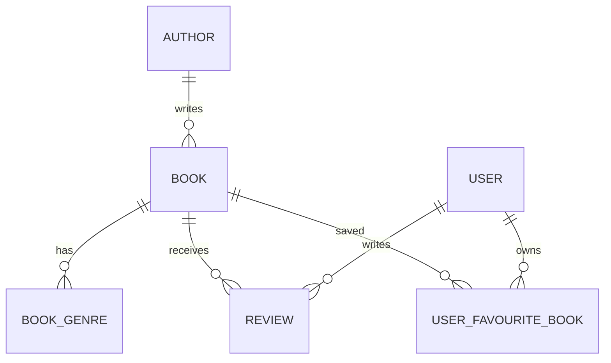

# BookHaven Implementation

- **Last updated:** 2026-11-23
- **Current phase:** Authenticated catalogue foundation

## Completed

- [x] Book domain includes title, short/long description, author, picture URL,
  multiple genres, pages, publish year, average stars, vote count, and reviews.
- [x] Author includes name and description.
- [x] Review includes user, book, text, stars, and creation time.
- [x] User includes email/password hash and favourite books; username removed.
- [x] Added `BookGenre` and `UserFavouriteBook` navigation entities.
- [x] Added one EF configuration file per entity.
- [x] Removed book create/update/delete repository and API operations.
- [x] Added authenticated `GetAllBooks`, `GetBook`, favourite, and review routes.
- [x] Split `BooksController`, `UsersController`, and `BaseController`.
- [x] Added minimal Program extensions for services, configuration, and pipeline.
- [x] Split every backend DTO and enum into its own file.
- [x] Guarded the whole frontend application behind login/register.
- [x] Removed header/footer from public auth routes.
- [x] Added top-right profile avatar with email and Logout dropdown.
- [x] Replaced local My Library persistence with authenticated favourites query.
- [x] Added automatic sign-out on API `401`.
- [x] Added eight application-service unit tests.
- [x] Added a VS Code full-stack task for the frontend and backend.
- [x] Configured API HTTP `5000`, HTTPS `7000`, and IIS Express SSL `44300`.
- [x] Added Swagger UI and automatic local opening at startup.
- [x] Added twelve deterministic catalogue books with Open Library covers.
- [x] Implemented catalogue search, genre filtering, sorting, pagination, and
  a responsive card grid with URL-backed filter state.
- [x] Implemented responsive book details with metadata, ratings, genres, and
  full descriptions.
- [x] Implemented favourite add/remove and server-backed My Library management.
- [x] Implemented review add/edit/delete with ownership enforcement.
- [x] Added password confirmation validation to frontend registration and API.
- [x] Simplified all card borders to standard solid borders.
- [x] Renamed the application service and interface to `BookService` and
  `IBookService`.
- [x] Kept white and gray as the interface foundation with black interaction
  states and buttons, red favourite hearts, gold ratings, and no gradients.
- [x] Added pointer feedback to interactive controls and underline-only header
  navigation states.
- [x] Reworked the profile avatar and dropdown with a neutral person icon.
- [x] Centered desktop navigation independently inside the full-width header.
- [x] Removed the catalogue list-view mode and redundant section kickers.
- [x] Aligned catalogue filters in a white panel beside the complete card grid.
- [x] Reworked book reviews into a server-backed summary, rating breakdown,
  review list, and centered rating/text modal without a display-name field.
- [x] Replaced constructed home and 404 artwork with responsive color image
  assets and removed the obsolete illustration markup/styles.
- [x] Removed the catalogue result-count row and made the filter panel size to
  its own content.
- [x] Reduced desktop navigation sizing, enlarged the profile control, and
  removed extra profile-menu list spacing.
- [x] Removed custom Fraunces/Inter font packages and overrides in favour of
  MUI's standard system typography.
- [x] Standardized functional icon rendering through MUI `SvgIcon`; only the
  BookHaven logo remains a custom brand SVG.
- [x] Added subtle reduced-motion-safe animation to the home and 404 images.
- [x] Made complete book cards open their details route while preserving the
  independent favourite action.
- [x] Confirmed book IDs as `Guid` values throughout the backend and opaque
  strings at the frontend boundary.
- [x] Added a back-to-catalogue control before the book-details breadcrumbs and
  replaced the catalogue search glyph with a clean MUI icon.
- [x] Added URL-backed server pagination to My Library.
- [x] Standardized black button hover states while keeping favourite selection
  visible only through the red heart.
- [x] Simplified review-modal typography and enlarged its rating control.
- [x] Removed imported/seeded rating values; rating summaries now derive only
  from BookHaven reviews and default to `0.0 / 5` with `0 ratings`.
- [x] Replaced the home and 404 foreground illustrations with the newly supplied
  coffee and cat images as responsive full-section backgrounds.
- [x] Removed the home My Library action and catalogue search icon.
- [x] Replaced the details-page library button with a large standalone favourite
  heart.
- [x] Standardized regular buttons to black with movement-only hover feedback,
  retaining Cancel as the secondary text-button style.
- [x] Enlarged the review-entry stars and changed the profile avatar background
  to neutral gray.
- [x] Normalized the existing SQLite rating summaries from local review rows so
  legacy imported totals are removed without deleting user data.
- [x] Allowed multiple reviews by the same user for one book by replacing the
  legacy unique review index with a non-unique index at startup.
- [x] Made the reviews-section action always add a blank review while each
  owned review retains independent Edit/Delete controls.
- [x] Removed hover movement from the profile control.

## Current schema

## Endpoints

| Method | Route | Auth |
| --- | --- | --- |
| `GET` | `/api/books` | Required |
| `GET` | `/api/books/{id}` | Required |
| `POST` | `/api/books/{id}/favourites` | Required |
| `DELETE` | `/api/books/{id}/favourites` | Required/owner |
| `POST` | `/api/books/{id}/reviews` | Required |
| `PUT` | `/api/books/reviews/{reviewId}` | Required/owner |
| `DELETE` | `/api/books/reviews/{reviewId}` | Required/owner |
| `POST` | `/api/users/register` | Public |
| `POST` | `/api/users/login` | Public |

## Verification

- [x] Backend build: 0 warnings, 0 errors.
- [x] Backend tests: 8 passed, 0 failed.
- [x] Frontend ESLint passed.
- [x] Frontend production build passed.

## Next work

- [ ] Replace deterministic seed data with an import only if the coursework
  requires a larger live catalogue.
- [ ] Add focused frontend component tests at the end of the project.
- [ ] Replace development JWT key for deployment.
- [ ] Introduce migrations when schema history is required.
